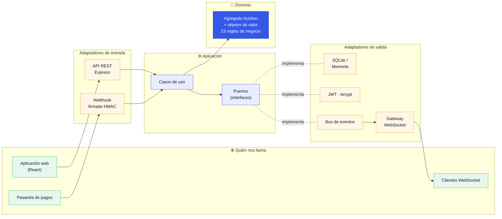
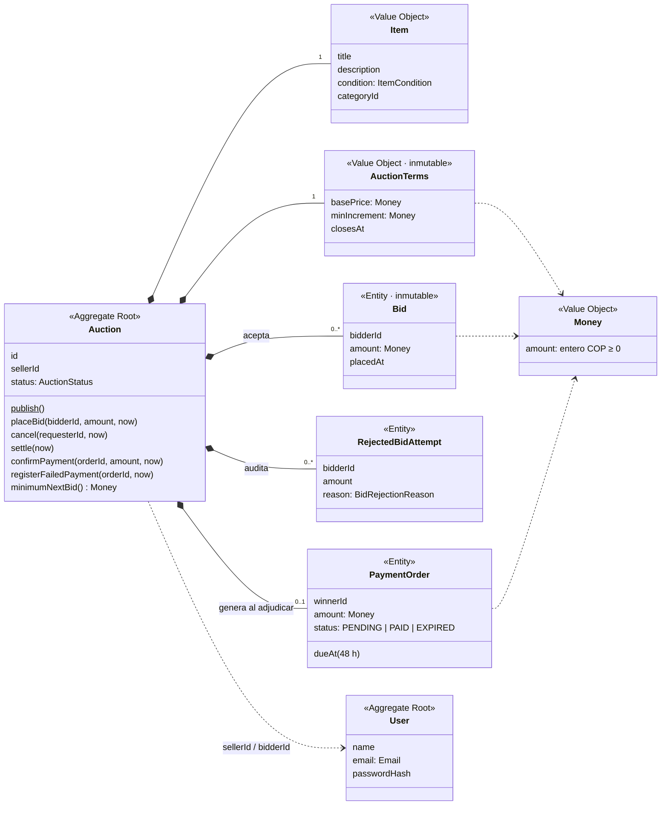
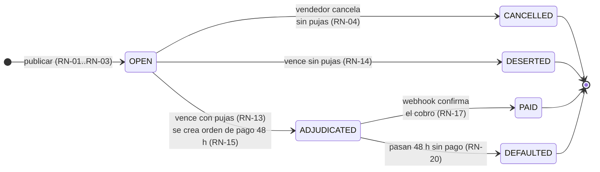
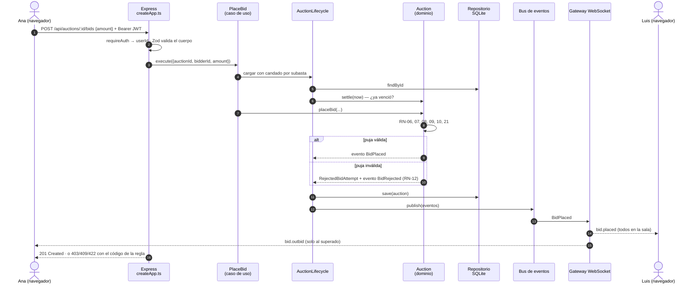
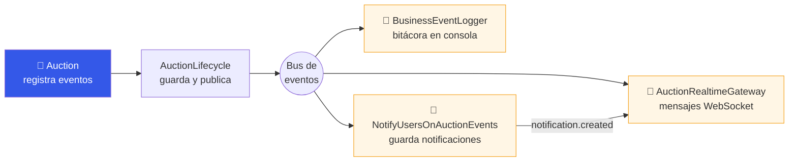
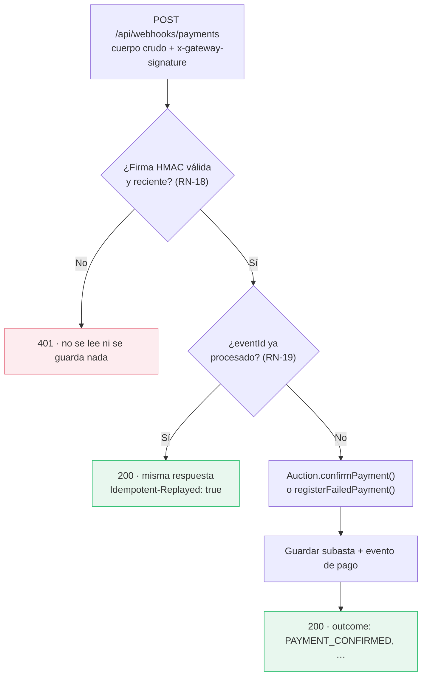

# Arquitectura — Plataforma de Subastas en Línea

> Equipo **Eso Va al Fallo** · Electiva II – Desarrollo · Tecnológico de Antioquia · 2026-02

Este documento explica **cómo está organizado el código y por qué**. Los diagramas están en Mermaid: GitHub los dibuja automáticamente.

**Contenido**

1. [Idea general: arquitectura hexagonal](#1-idea-general-arquitectura-hexagonal)
2. [Las tres capas](#2-las-tres-capas)
3. [Estructura de carpetas](#3-estructura-de-carpetas)
4. [Modelo de dominio](#4-modelo-de-dominio)
5. [Ciclo de vida de una subasta](#5-ciclo-de-vida-de-una-subasta)
6. [Recorrido de una puja de punta a punta](#6-recorrido-de-una-puja-de-punta-a-punta)
7. [Eventos de dominio y tiempo real](#7-eventos-de-dominio-y-tiempo-real)
8. [Webhook de pagos](#8-webhook-de-pagos)
9. [Puertos y adaptadores](#9-puertos-y-adaptadores)
10. [Raíz de composición](#10-raíz-de-composición)
11. [Frontend](#11-frontend)
12. [Ramas y commits](#12-ramas-y-commits)

---

## 1. Idea general: arquitectura hexagonal

El **dominio** (las reglas del negocio de subastas) está en el centro y **no depende de nada externo**: ni de Express, ni de la librería de WebSockets, ni de SQLite. Todo lo técnico vive afuera y se conecta mediante **puertos** (interfaces) y **adaptadores** (implementaciones).



**¿Por qué así?**

| Beneficio | En este proyecto |
|---|---|
| Las reglas se prueban sin servidor ni base de datos | `tests/domain/*` corre en milisegundos |
| La persistencia se cambia con una variable | `PERSISTENCE=sqlite` o `PERSISTENCE=memory` (RNF-06) |
| El dominio no se "contamina" con detalles técnicos | `npm run check:domain` lo verifica automáticamente |
| El tiempo real no ensucia los casos de uso | Los casos de uso publican eventos; el gateway WebSocket los escucha (RNF-05) |

---

## 2. Las tres capas

| Capa | Carpeta | Responsabilidad | Puede importar |
|---|---|---|---|
| 💎 **Dominio** | `src/domain` | Reglas de negocio, entidades, objetos de valor, eventos | Solo el propio dominio |
| ⚙️ **Aplicación** | `src/application` | Orquestar casos de uso, definir puertos, convertir a DTO | Dominio |
| 🔌 **Infraestructura** | `src/infrastructure` | HTTP, WebSocket, SQLite, JWT, bcrypt, reloj, logs | Aplicación y dominio |

La regla de dependencia va **siempre hacia adentro**: infraestructura → aplicación → dominio.

---

## 3. Estructura de carpetas

```text
ELECTIVAII_PlataformaSubastas/
├── src/
│   ├── domain/                      💎 Reglas del negocio (sin librerías externas)
│   │   ├── auction/                 Agregado principal
│   │   │   ├── Auction.ts           Raíz del agregado: publicar, pujar, cancelar, cerrar, pagar
│   │   │   ├── AuctionTerms.ts      Precio base, incremento, cierre (inmutables, RN-05)
│   │   │   ├── Bid.ts               Puja aceptada (nunca se modifica, RN-11)
│   │   │   ├── RejectedBidAttempt.ts Intento rechazado con su motivo (RN-12)
│   │   │   ├── PaymentOrder.ts      Orden de pago del ganador (RN-15, RN-17, RN-20)
│   │   │   ├── AuctionEvents.ts     Hechos del negocio (BidPlaced, AuctionAdjudicated…)
│   │   │   └── …Status, Item, ItemCondition, BidRejectionReason
│   │   ├── user/                    User, Email (objeto de valor)
│   │   ├── category/  notification/  payment/
│   │   └── shared/                  Money (COP, RN-21), AggregateRoot, DomainError
│   │
│   ├── application/                 ⚙️ Casos de uso
│   │   ├── use-cases/               Un archivo por caso de uso (RF-01 … RF-20)
│   │   ├── services/AuctionLifecycle.ts  Carga, cierra si venció y guarda (con exclusión mutua)
│   │   ├── event-handlers/          Notificaciones persistentes ante cada evento
│   │   ├── ports/                   Interfaces: repositorios, reloj, tokens, eventos…
│   │   ├── dto/views.ts             Lo que sale hacia afuera (sin datos privados)
│   │   └── errors/                  ApplicationError (NOT_FOUND, FORBIDDEN…)
│   │
│   ├── infrastructure/              🔌 Detalles técnicos
│   │   ├── http/                    Express: rutas, autenticación, traducción de errores
│   │   ├── websocket/               Salas por subasta y avisos personales
│   │   ├── persistence/sqlite/      Repositorios SQLite (node:sqlite nativo)
│   │   ├── persistence/memory/      Repositorios en memoria (pruebas / Entrega 1)
│   │   ├── security/                JWT, bcrypt, firma HMAC del webhook
│   │   ├── events/                  Bus de eventos en proceso + bitácora del negocio
│   │   ├── system/                  Reloj (con desfase de demo), UUID, logger
│   │   └── config/env.ts            Lectura y validación del .env
│   │
│   ├── bootstrap.ts                 Raíz de composición: conecta todas las piezas
│   └── main.ts                      Punto de entrada: lee .env y escucha en el puerto
│
├── tests/                           Vitest
│   ├── domain/                      Reglas de negocio puras
│   ├── application/                 Webhook (firma + idempotencia)
│   ├── infrastructure/              Contrato común de repositorios (memoria y SQLite)
│   └── e2e/                         Flujo completo por HTTP + WebSocket + webhook
│
├── frontend/                        Aplicación web React + Vite (SubastaYa)
├── scripts/                         Simulador de pasarela, cliente WS, verificación de capas
└── docs/                            Esta documentación + openapi.yaml + api.http
```

---

## 4. Modelo de dominio

`Auction` es la **raíz del agregado**: todo cambio sobre pujas, cierre u orden de pago pasa por ella, así las reglas nunca se pueden saltar.



**Objetos de valor** (`Money`, `Email`, `AuctionTerms`, `Item`, `AuctionStatus`…) se validan al crearse y son inmutables: es imposible tener un `Money` negativo o con decimales en memoria.

---

## 5. Ciclo de vida de una subasta



**¿Quién dispara el cierre?** Dos mecanismos, ambos en `AuctionLifecycle`:

- **Cierre perezoso:** cada vez que alguien consulta una subasta o el listado, primero se evalúa si ya venció (RF-08).
- **Cierre periódico:** cada 5 segundos `bootstrap.ts` llama `settleAllDue()` para cerrar las vencidas aunque nadie las consulte, y así los WebSockets avisan a tiempo.

El reloj llega al dominio por el puerto `Clock`. En la demostración, `SystemClock` acepta un desfase (`/api/dev/clock/advance`) para mostrar cierres sin esperar horas.

---

## 6. Recorrido de una puja de punta a punta



**Concurrencia:** `KeyedMutex` garantiza que dos pujas simultáneas sobre la **misma** subasta se procesen una tras otra, así nunca se aceptan dos pujas "ganadoras" a la vez.

---

## 7. Eventos de dominio y tiempo real

El agregado **registra hechos** (`AuctionPublished`, `BidPlaced`, `BidRejected`, `AuctionCancelled`, `AuctionDeserted`, `AuctionAdjudicated`, `PaymentConfirmed`, `PaymentFailed`, `PaymentOrderExpired`). Después de guardar, `AuctionLifecycle` los publica en el `InProcessEventBus`, que los reparte a tres suscriptores independientes:



Si un suscriptor falla, el bus lo registra y sigue con los demás: un error enviando un WebSocket nunca deshace una puja ya guardada.

El protocolo completo de mensajes WebSocket está en [`openapi.yaml`](openapi.yaml) (sección de descripción) y se ve en `http://localhost:3000/docs`.

---

## 8. Webhook de pagos



- La firma usa `HMAC-SHA256(secreto, "<timestamp>.<cuerpo>")` y se compara en tiempo constante.
- La antigüedad de la firma se mide con la **hora real**, no con el reloj de negocio, para que adelantar el reloj en la demo no invalide pagos legítimos.
- El pago **solo** se confirma por esta vía (RN-17): no existe un endpoint para que un usuario marque su orden como pagada.

---

## 9. Puertos y adaptadores

| Puerto (aplicación) | Adaptador (infraestructura) | Para qué |
|---|---|---|
| `UserRepository`, `AuctionRepository`, `CategoryRepository`, `NotificationRepository`, `PaymentEventRepository` | `Sqlite*Repository` · `InMemory*Repository` | Persistencia intercambiable (RNF-04, RNF-06) |
| `Clock` | `SystemClock` | Hora del negocio (con desfase de demo) |
| `IdGenerator` | `UuidGenerator` | Identificadores únicos |
| `PasswordHasher` | `BcryptPasswordHasher` | Contraseñas cifradas |
| `TokenService` | `JwtTokenService` | Sesión con JWT |
| `EventPublisher` | `InProcessEventBus` | Anunciar hechos del negocio (RNF-05) |
| `RealtimeUserNotifier` | `AuctionRealtimeGateway` | Avisos personales en vivo |
| `WebhookSignatureVerifier` | `HmacWebhookSignatureVerifier` | Verificar el origen del webhook |
| `Logger` | `ConsoleLogger` | Registro de actividad |

Los dos juegos de repositorios cumplen **el mismo contrato de pruebas** (`tests/infrastructure/auctionRepositoryContract.test.ts`), así se garantiza que son intercambiables.

---

## 10. Raíz de composición

`src/bootstrap.ts` es el **único archivo que conoce todas las piezas**. En seis pasos:

1. Crea los servicios técnicos (reloj, ids, bcrypt, JWT, verificador del webhook).
2. Elige la persistencia según `PERSISTENCE` y carga las categorías iniciales.
3. Crea el bus de eventos y le suscribe la bitácora, el gateway WebSocket y las notificaciones.
4. Instancia los casos de uso inyectándoles sus puertos.
5. Crea el servidor HTTP con Express y le adjunta el WebSocket en `/ws` (mismo puerto).
6. Programa el cierre periódico de subastas vencidas.

`src/main.ts` solo lee el `.env`, llama `bootstrap()` y pone a escuchar el servidor. La prueba `tests/e2e/httpFlow.test.ts` usa el mismo `bootstrap()` con persistencia en memoria.

---

## 11. Frontend

Aplicación **React 19 + Vite + TypeScript** en `frontend/` (marca *SubastaYa*).

```text
frontend/src/
├── App.tsx                    Encabezado, catálogo, navegación por hash (#/subasta/:id, #/cuenta)
├── pages/
│   ├── AuctionDetail.tsx      Detalle, pujar, contador, historial en vivo, cancelar, resultado
│   └── MyAccount.tsx          Perfil, órdenes de pago, publicadas y participaciones
├── components/
│   ├── AuthModal.tsx          Registro e inicio de sesión
│   ├── PublishAuctionModal.tsx Formulario de publicación
│   ├── NotificationsPanel.tsx Campana con avisos
│   ├── Toasts.tsx  Modal.tsx
├── services/
│   ├── auctionService.ts      Cliente de la API REST (único punto de contacto con el backend)
│   └── realtime.ts            Una conexión WebSocket por sesión, con reconexión automática
└── utils/format.ts            Pesos COP, tiempo restante, etiquetas de estado, imágenes
```

- El token se guarda en `localStorage` y se envía como `Authorization: Bearer`.
- Si el servidor responde 401, la sesión se cierra sola.
- Sin sesión, el catálogo muestra una invitación a registrarse (RN-23).
- El backend no maneja fotos; el frontend muestra imágenes ilustrativas según la categoría.

---

## 12. Ramas y commits

**Flujo de trabajo:** cada funcionalidad en su rama `feature/*`, integración a `main` mediante *Pull Request* revisado.

| Rama | Contenido |
|---|---|
| `chore/project-setup` | Configuración inicial: TypeScript, Vitest, dependencias |
| `feature/domain-model` | Agregado `Auction`, objetos de valor y reglas de negocio |
| `feature/application-use-cases` | Casos de uso y puertos de salida |
| `feature/sqlite-persistence` | Repositorios en memoria y SQLite |
| `feature/realtime-websocket` | Gateway WebSocket suscrito a eventos de dominio |
| `feature/payment-webhook` | Webhook firmado con idempotencia |
| `feature/http-api` | API REST, raíz de composición, Swagger y prueba E2E |
| `docs/architecture` | Esta documentación |

**Convención de commits** ([Conventional Commits](https://www.conventionalcommits.org/es/)):

```text
<tipo>(<alcance>): <descripción en imperativo>

feat(domain): added auction aggregate, value objects and business rules
feat(ws): added realtime gateway subscribed to domain events
fix(application): agregado metodo para buscar los ID pendientes de liquidar
docs(architecture): agregar diagramas de capas y del flujo de pujas
```

Tipos usados: `feat` (funcionalidad), `fix` (corrección), `chore` (configuración), `docs` (documentación), `test` (pruebas), `refactor` (reorganización sin cambiar comportamiento).
